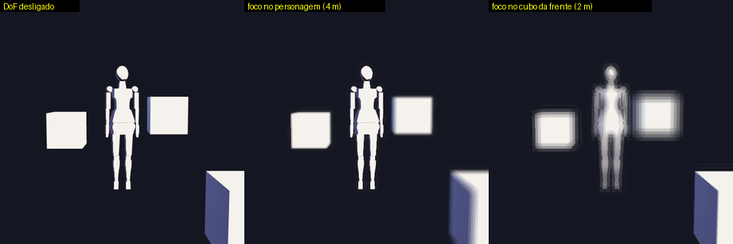
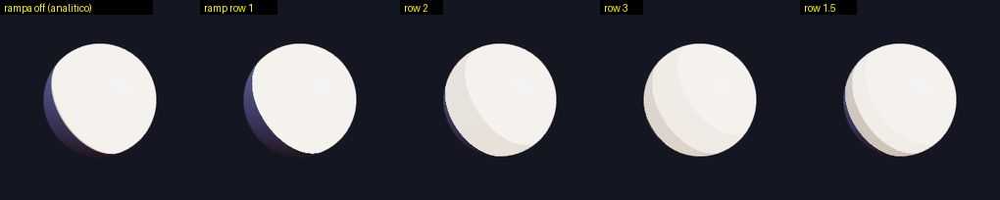
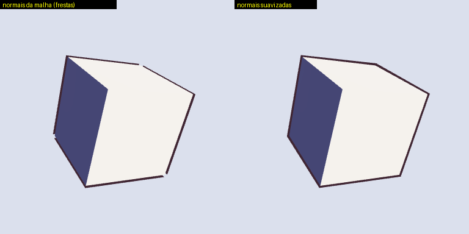
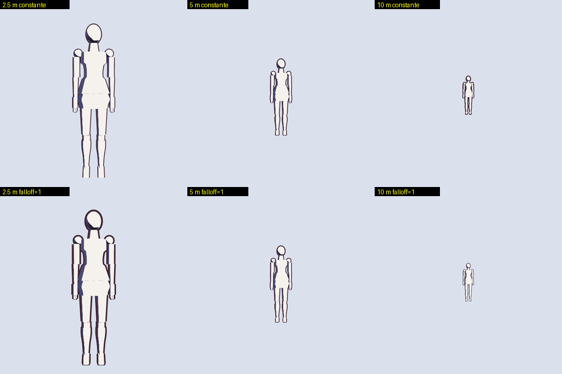
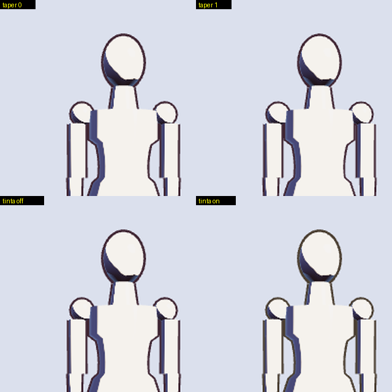
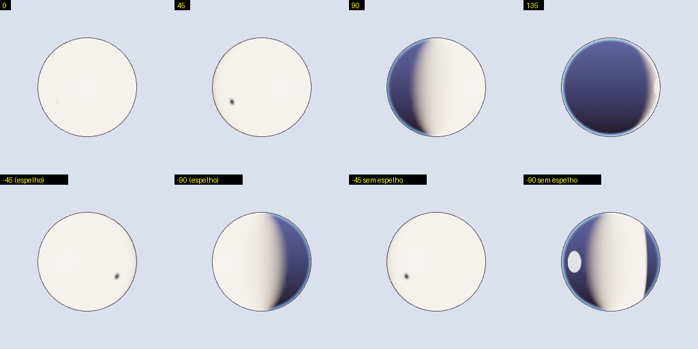

# Motor cel anime — Fase 0 e Fase 1

Relatório do que foi implementado a partir do roadmap de `docs/native/pesquisa/cel_shading_estado_da_arte.md`
(itens da Fase 0 e da Fase 1 de linha). Tudo foi validado com renderização real em Vulkan por software
(lavapipe/llvmpipe): as imagens abaixo saem de `HeadlessRenderer::render_scene` e foram inspecionadas.

Regra seguida em todos os recursos: **o valor padrão de cada parâmetro novo reproduz o motor anterior byte a byte**.
Os hashes de `crates/anigo-renderer/tests/golden_frames.rs` da base feminina (`0xbaa8e1f74abe3d5d`) e do cubo com
contorno (`0xd24406b5945fdd58`) continuam idênticos; só o hash do DoF mudou, de propósito (ver 1).

Para regenerar as imagens: `cargo run -p anigo-renderer --example cel_gallery -- <pasta> [cena ...]`
(catálogo de cenas em `crates/anigo-renderer/examples/cel_gallery.rs`).

## 1. DoF: triângulo degenerado, `textureSampleLevel` e halo

- **Bug**: `vs_dof` emitia `(-1,-3), (1,-1), (3,1)`, três pontos colineares. O passe nunca rasterizava e todo quadro com DoF
  saía zerado. Agora emite o fullscreen triangle `(-1,-1), (3,-1), (-1,3)`.
- **Uniformidade de derivadas**: a pesquisa estava certa. `fs_dof` fazia `textureSample` depois de um `return` por pixel
  (`radius_px < 0.5`). Passou a `textureSampleLevel(..., 0.0)` (sem mipmaps é o mesmo texel). O `naga` não acusa isso
  (a validação continua verde antes e depois); o Tint/Chrome acusaria.
- **Halo (extra, visível na inspeção)**: com o passe funcionando, o fundo desfocado "bebia" a cor do personagem em foco e
  desenhava um halo claro em volta dele. As amostras do disco agora têm peso por profundidade: uma amostra à frente do
  pixel só contribui se o próprio círculo de confusão dela alcança o centro; amostras atrás entram sempre.
- `GOLDEN_DOF`: `0x9c735bed0a722325` (quadro 100% zerado) → `0x948e8b8f09ccd6ff`. O teste agora exige quadro não vazio.

Não ficou perfeito: são 16 amostras fixas, então com raio grande (16 px) o bokeh mostra anéis/fantasmas (visível no
terceiro painel). Aumentar o número de amostras ou girar o disco por pixel é trabalho futuro.

## 2. Rampa 2D por material

A amostra `ramp_sample` era descartada. Agora é usada quando o material liga a rampa.

- Linha da rampa = `ramp_row` (0 contínua, 1 um degrau, 2 dois, 3 três; fração interpola entre linhas).
- Coluna = half-lambert deslocado pelo limiar de sombra (o degrau cai em 0,5 quando `half_lambert == shadow_threshold`).
- Fator final = `mix(analítico, rampa, ramp_blend)`. Com `ramp_blend = 0` a textura nem é amostrada.

A linha 1 coincide com o analítico de 1 degrau exceto na borda do terminador (577 de ~65 mil pixels): a rampa tem borda
dura de 1 texel, o analítico tem `smoothstep` de `shadow_smoothness`. Em modo rampa a penumbra é a que a rampa desenha.

## 3. Contorno (inverted hull) de alta qualidade

O vértice de 72 B e o do cel **não mudaram**.

- **Normais suavizadas** (`outline_smooth_normals`): segundo stream de vértices só do pipeline `outline` (location 6,
  12 B/vértice, declarado em `vertex_layout.outline_stream` do contrato). Calculadas no Rust ao subir o vertex buffer
  (`anigo_core::npr::smooth_outline_normals`): soldagem por posição + média das normais de face ponderada pelo ângulo
  interno (independe da triangulação), com cache por geometria. Em morphs via GPU as normais vêm da malha base.
- **Largura por distância/FOV** (`outline_distance_falloff`): `escala = clamp((ref_eff / profundidade)^falloff, piso, 4)`,
  com `ref_eff = ref_distance · tan(22,5°) / tan(fov/2)` calculado no host (a linha acompanha o zoom da lente).
  Forçado a 0 em câmera ortográfica. `outline.params2.z` estava livre, confirmado; `params2.w` também.
- **Taper** (`outline_taper`): largura × `(1 − taper · 0,75 · |N·V|)`. Em termos práticos, silhueta externa cheia e
  linhas internas (onde a superfície encara a câmera) mais finas.
- **Tinta por material** (`outline_ink_*`): cor da linha derivada da cor base em HSV (satura e escurece), calculada no
  host; o shader só recebe `outline.color`.
- `OutlineUniform` foi de 48 para 64 B (`params3` novo: taper e piso).

Cubo girado com contorno largo: normais da malha abrem frestas visíveis em três cantos; as suavizadas fecham todas.

Base feminina a 2,5 / 5 / 10 m (linha nominal 0,008 em NDC, ≈2 px a 512 px). Em cima, espessura constante em pixels
(o motor anterior); embaixo, `falloff = 1`, `ref_distance = 5`, piso 0,2: engrossa perto, afina ao longe.
Contagem de pixels de linha por pixel de altura: constante 7,0 / 6,1 / 5,9; com falloff 15,0 / 6,1 / 2,0.

Taper (em cima) e tinta (embaixo), recorte ampliado 1,6×:

## 4. Face SDF

- **Espelhamento**: o mapa é autorado para luz em +X local (theta ≥ 0); com theta < 0 amostra `u' = 2·centro − u`
  (`face_sdf_mirror_uv`, no bloco compartilhado `face_sdf.wgsl` == `cel_shading.wgsl`). Parâmetro `face_sdf_mirror_center`.
- **Cor**: a sombra facial usa a cor de sombra do material (`mix(base_cel, min(base_cel, shadow_color), fator)`), não mais
  `base_cel * 0.72`.
- **Cabeça**: os eixos X/Z do rosto vêm da junta 7 (Head) da paleta de skinning, levados ao mundo no vertex shader. Com
  paleta identidade são as colunas 0/2 do modelo (comportamento anterior). O dado existe no `Scene` (`skin.palette`).
  Limitação: a junta 7 é a do esqueleto canônico de 24 ossos; outro rig precisa remapear.
- **Mapa**: `HeadlessRenderer::set_face_sdf_map` (R8) e `set_face_sdf_map_f32` (R16Float) ancoram o mapa no binding 16 dos
  materiais com `face_sdf_enabled`; sem mapa continua o neutro 1x1. `face_sdf_map::procedural_face_sdf` gera um mapa de
  demonstração (varredura lateral + mancha do nariz); não é arte final.
- O mapeamento theta → limiar **não mudou** (goldens 0/45/90/135° do contrato intactos).

Esfera-cabeça, luz a 0/45/90/135° (em cima) e −45/−90° (embaixo à esquerda, com espelho; à direita, sem espelho: a sombra
cai do lado da luz, errado):

## 5. Módulo `anigo-core::npr` e paridade com o WGSL

`crates/anigo-core/src/npr.rs`: `NprParams` e a matemática pura (rampa, largura/taper, tinta, normal suavizada, face SDF,
frame da cabeça). Cada função tem testes `golden_*`. Além disso, `crates/anigo-renderer/tests/shader_math_parity.rs`
extrai o **texto** das funções dos arquivos de produção, executa num compute shader na GPU e compara com o Rust
(theta, limiar, fator, espelho, largura, taper, rampa). Trocar uma constante num lado derruba o teste (verificado).
Normal suavizada e tinta são só Rust, por design.

## 6. Parâmetros novos

Todos em `StylizedMaterial::npr` (`NprParams`), omitidos da serialização enquanto no padrão; `MaterialPatch.npr` substitui
o grupo. Detalhe no contrato (`contracts/fixtures/render_contract_v1.json`, seção `npr`).

| Parâmetro | Faixa | Padrão | Uniform | Efeito |
|---|---|---|---|---|
| `ramp_blend` | 0..1 | 0 | `material.params6.w` | 0 = rampa desligada; 1 = rampa decide o fator de luz |
| `ramp_row` | 0..3 | 1 | `material.params7.w` | linha da rampa; fração interpola |
| `outline_smooth_normals` | 0..1 | 0 | stream 2 (location 6) | mistura normal da malha / suavizada |
| `outline_distance_falloff` | 0..1 | 0 | `outline.params2.z` | 0 = px constante; 1 = proporcional ao tamanho projetado |
| `outline_ref_distance` | 0,05..1000 m | 4 | `outline.params2.w` (efetiva) | distância da largura nominal (FOV 45°) |
| `outline_min_width_scale` | 0..1 | 0 | `outline.params3.y` | piso da escala por distância |
| `outline_taper` | 0..1 | 0 | `outline.params3.x` | afina onde a superfície encara a câmera, até 25% |
| `outline_ink_blend` | 0..1 | 0 | `outline.color` (host) | 0 = `outline_color`; 1 = tinta da cor base |
| `outline_ink_darken` | 0..1 | 0,7 | host | V × (1 − darken) |
| `outline_ink_saturation` | 0..3 | 2,5 | host | multiplicador de saturação HSV |
| `face_sdf_mirror_center` | 0..1 | 0 | `material.params8.w` | 0 = sem espelho; >0 = u do eixo de simetria |

Os padrões são **conservadores**: nada disso liga sozinho. Quem quiser o visual "anime" precisa ligar
(`smooth_normals = 1`, `falloff ≈ 0,8..1`, `taper ≈ 0,5`, `ink_blend ≈ 0,7` foi o que usei nas imagens).

## 7. Contrato, TS legado e testes

Fixtures regeneradas por `node scripts/gen_contract_fixtures.mjs`. Mudanças no contrato: `outline` 48 → 64 B,
`vertex_layout.outline_stream`, seção `npr`, notas de `face_sdf` (campo `darkening` removido). No app web legado só o
necessário para os testes: packer de `params3`, segundo buffer de vértice no pipeline de contorno (o próprio VBO, sem
suavização), `NprParamsWire`, referência TS da face SDF com a fórmula nova e asserções de texto ajustadas.

## 8. O que NÃO ficou bom / exige validação humana

- **Gosto**: espessura nominal, `ref_distance`, piso, taper e a tinta (o marrom derivado de pele clara sai meio oliva).
  Nada disso foi afinado com olho de artista; as imagens provam ausência de buracos e a direção do efeito, não beleza.
- **Linha padrão quase invisível**: a largura padrão (0,0035 NDC) é ≈0,9 px a 512 px; o contorno do motor anterior só
  aparece em resoluções altas ou com largura maior. Não mexi, para não quebrar o frame congelado.
- **Taper**: efeito sutil nas silhuetas; só diferencia peso entre contorno externo e linhas internas.
- **Face SDF**: com o mapeamento theta → limiar existente (congelado no contrato), a sombra só aparece de verdade acima de
  ~60°: a 45° é uma lasca. Não há textura de rosto real no pipeline; o mapa procedural é só demonstração. O espelhamento
  assume mapa autorado para +X e eixo de simetria informado; não há detecção automática.
- **Rampa**: sem textura de rampa por material (só as 4 linhas do contrato); a penumbra é a da rampa.
- **Contorno com morphs na GPU**: normais suavizadas vêm da malha base (podem ficar levemente defasadas).
- **Viewport TS**: o contorno de suavização/falloff/taper não existe lá (usa a normal da malha e parâmetros zerados).
- Não feitos (fora do escopo pedido): HDR/tonemap neutro, `edge_post`, shadow map, tangente de fio, cabelo translúcido.
