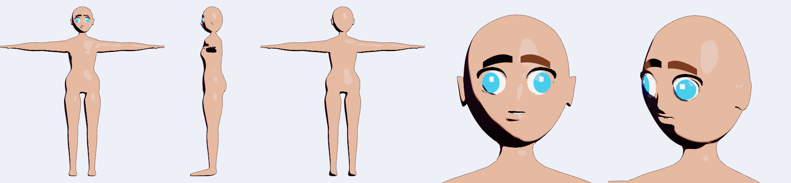
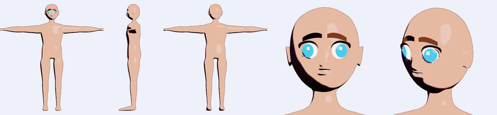
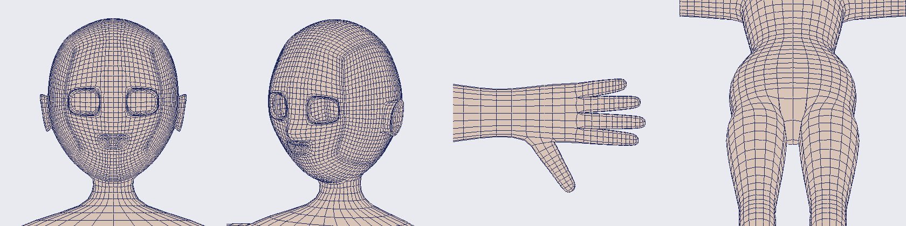
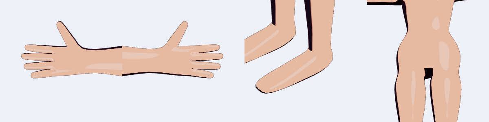
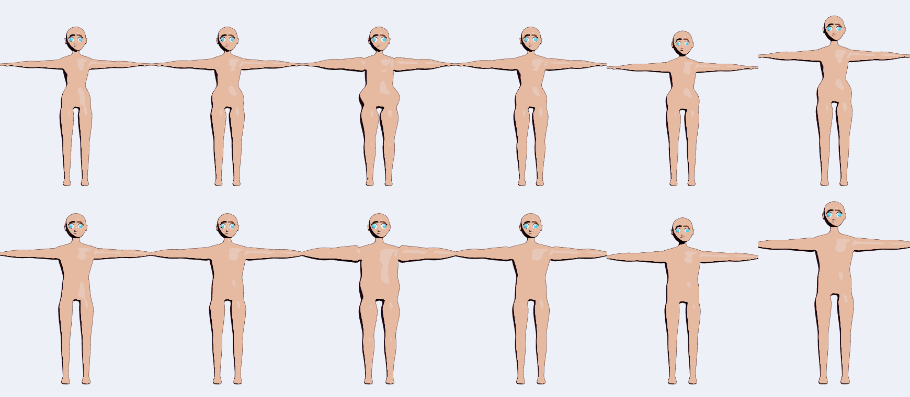
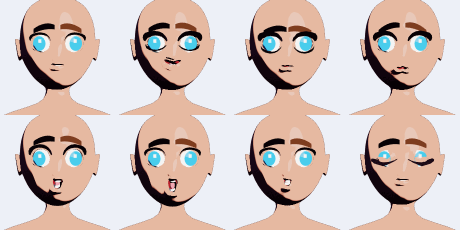

# ANIGO - Personagem base v2 (Gen-0): `anigo-charbase`

Estado: **Gen-0 por contrato**, gerada e testada **na nuvem, sem GPU real e sem olho humano sobre as suas referências** (`C:\ANIGO\IMAGENS`). A malha é um **manequim anatômico limpo**: topologia, loops, simetria, esqueleto, pesos e morphs estão corretos *por construção e por teste*; a **beleza do rosto e das proporções anime não está** (seção 9). O usuário esculpe só **posições** localmente e o sistema re-deriva o resto.

Nada do que existia foi alterado: o mesh canônico de 4 patches do `anigo-core`, os GLBs de `assets/models/`, o `render_contract` (paleta de 24 ossos) e os goldens ficam como estavam. A base nova mora **ao lado**, num crate novo.

| Onde | O quê |
|---|---|
| `crates/anigo-charbase/` | gerador, esqueleto, pesos, morphs, contrato, exportador, preview, testes |
| `assets/models_v2/anime_female_v2.glb`, `anime_male_v2.glb` | os dois personagens (GLB com skin de 65 ossos, morph targets nomeados e a camada `VRMC_vrm` 1.0), ~4,2 MB cada |
| `assets/models_v2/topology_contract.json` | contrato de topologia (contagens, hash, laços, grupos, landmarks, ossos, peças, morphs) |
| `docs/native/img/charbase_*.png` | folha de modelo e figuras (renderer cel headless, lavapipe) |
| `crates/anigo-studio/src/library.rs` | `assets/models_v2` entra na Biblioteca como local ligado "Bases v2 (Gen-0)" |

Comandos (todos determinísticos; rodar duas vezes gera os mesmos bytes):
```bash
cargo run --release -p anigo-charbase --example export_models      # regenera assets/models_v2/*
cargo run -p anigo-charbase --example render_sheet                  # regenera docs/native/img/charbase_*.png (lavapipe)
cargo run -p anigo-charbase --example check_sculpt -- meu.glb       # valida uma pele esculpida e re-deriva esqueleto/pesos
cargo run -p anigo-charbase --example dev_view -- /tmp/x f front,head wire skel parts   # inspeção rápida em CPU
cargo test -p anigo-charbase                                        # 49 testes (~45 s em debug)
```




## 1. O que foi construído

1. **Gerador procedural** `generate(Gender::Male | Female | Blend(t)) -> BaseCharacter` (e `generate_with(&Params)`): **Skin** único (corpo e cabeça soldados), só quads, simétrico em X, com os loops obrigatórios da tabela F1/A1 da pesquisa. Masculino e feminino são **isomórficos** (mesma contagem, ordem de vértices, conectividade, UV e pesos); o gênero é um parâmetro contínuo.
2. **Peças auxiliares como submalhas**: olhos em camadas (esclera, íris côncava, brilho), cílios, sobrancelhas, interior da boca (cavidade, dentes, língua). São funções das posições do Skin, então seguem qualquer morph ou escultura.
3. **Esqueleto VRM humanoid completo** (55 ossos, hierarquia exata da spec) mais 8 ossos de twist e 2 de busto, em T-pose, cada osso posicionado por um **localizador de junta** (combinação afim fixa de vértices): o esqueleto é re-derivado de qualquer malha com a mesma topologia.
4. **Pesos de skin iniciais**: soma 1, no máximo 4 influências, suaves em ombros/quadris, dedos por falange, sem vazamento entre braços, tronco e pernas.
5. **Morphs** como alvos esparsos aditivos: 12 macros (gênero, idade, peso, músculo, altura, cabeça), 36 de rosto (18 parâmetros em duas polaridades) e **16 expressões VRM** (neutral + 15 deformações).
6. **Contrato de topologia** (`topology_contract.json`) + `validate_topology` + `rederive` (re-localiza juntas e transfere pesos por vizinho mais próximo se a topologia mudou).
7. **Exportação** GLB com skin de 65 ossos, `extras.targetNames`, múltiplos materiais/submalhas, accessors esparsos, e VRM 1.0 (via exportador do `anigo-vrm`).
8. **Preview sem mexer no renderer**: `collapse_to_canonical24` reduz 65 ossos para os 24 do núcleo só para visualizar; folha de modelo renderizada pelo cel headless.

## 2. Especificação do mesh base

### 2.1 Como é construído (e por que a topologia é limpa)

O Skin é uma **gaiola de quads de baixa resolução subdividida uma vez (Catmull-Clark)**. A gaiola é montada por partes que se ligam por índices (nada de soldar por posição):

- **Cabeça**: cubo-esfera equiangular de 13x13 células por face, com buracos para pescoço (5x3 células), olhos (3x3), boca (5x2) e orelhas (3x3). Cada buraco ganha **anéis concêntricos** construídos a partir do contorno do buraco (pálpebras, lábios, concha da orelha), então a conectividade é sempre a mesma.
- **Tronco**: anéis de 16 vértices **sem vértice em x = 0** (o plano de simetria passa pelo meio das arestas), do pescoço à virilha, com os buracos dos ombros (3x3 células = 12 vértices).
- **Braços**: tubos de 12 vértices que se ligam por ponte ao buraco do ombro; a seção do pulso vira a palma (retângulo 4x2 células = 12 vértices); os **4 dedos** saem das faces da grade distal (6 vértices por anel) e o **polegar** da faixa lateral da palma.
- **Pernas**: divisão em "calça": o último anel do tronco (16) vira dois anéis de 8, com uma face de assoalho na virilha; o pé é o tubo que dobra para a frente e fecha na ponta com tampa.
- Depois da subdivisão (`1 nível`) cada anel da gaiola vira **dois** loops e os anéis de 12/16/8 viram 24/32/16: o resultado é denso, liso e 100 % quad.

### 2.2 Contagens reais (medidas, feminino = masculino)

| Item | Valor |
|---|---|
| Vértices do Skin | **10 205** (2 560 da gaiola + pontos de aresta e de face) |
| Faces | **10 168 quads** (zero triângulos), 20 374 arestas |
| Característica de Euler | -1 (esfera com 3 discos removidos) |
| Laços de fronteira | 3 (olho esquerdo, olho direito, boca; o interior fecha nas peças auxiliares) |
| Valência | 98,08 % regulares (4); 140 de valência 3 (pontas de dedos e polos da cabeça), 44 de 5, 12 de 6 (virilha, narinas) |
| Por região | cabeça 4 648, pescoço 192, tronco 945, braços 1 248, mãos 300, dedos 5 x ~302, pernas 960, pés 192, dedos do pé 210 |
| Vértices no GLB (primitivo da pele) | 10 857 (10 205 + 652 duplicatas de costura de UV) |
| Peças auxiliares | 14 peças, 965 vértices, 1 636 triângulos |
| Total renderizado | ~11 800 vértices, ~22 000 triângulos (alvo da pesquisa: 10-14 k vértices no Skin) |
| Cabeças de altura | feminino 1,60 m / cabeça 0,25 m (6,3); masculino 1,72 m / 0,256 m (6,7); a proporção anime é o macro `head_big`/`head_small` |

O alvo de 10 a 14 k vértices foi atingido na faixa baixa de propósito: dá folga para o usuário subdividir regiões ou adicionar detalhe sem passar de 14 k.

### 2.3 Loops obrigatórios (tabela F1/A1) - todos testados como ciclos fechados de arestas

| Região | Laços nomeados no contrato (`loops`) |
|---|---|
| Olho (cada) | `eye_{L,R}_ring0..3`: contorno de transição para a bochecha + 3 anéis (periorbital, crista da pálpebra, margem da pálpebra); como a subdivisão dobra, existem **7 loops concêntricos** em volta de cada olho |
| Sobrancelha | `brow_line` (cadeia na crista superciliar) |
| Nariz | `nose_alar_ring` (asas) e `nose_tip_ring` (ponta) |
| Boca | `mouth_ring0..3`: pele, borda do vermelhão, lábio e fenda; 7 loops concêntricos |
| Mandíbula/queixo | `jaw_base_loop` (perímetro da base do crânio), `chin_line` |
| Orelha | `ear_{L,R}_ring0..3` + tampa 3x3 da concha |
| Pescoço | `neck_ring0..2` (3 anéis na gaiola = 5 loops) |
| Ombro | `shoulder_hole_{L,R}`, `clavicle_loop`, `axilla_row` |
| Cotovelo / joelho | 3 anéis na gaiola (`elbow_*_ring0..2`, `knee_*_ring0..2`) = 5 loops cada |
| Punho / tornozelo | `wrist_*_ring0..1`, `ankle_*_ring0..1` |
| Dedos | por dedo `finger_{lado}_{dedo}_{mcp,pip,dip}` (thumb: `cmc,mcp,ip`): 7 anéis por dedo na gaiola, juntas nos anéis 0, 2, 4, ou seja, **~3 loops por falange** depois da subdivisão; `palm_*_knuckle_loop`, `palm_*_mid_loop` |
| Cintura / quadril | `waist_loop`, `navel_loop`, `pelvis_loop_a/b`, `crotch_loop`, `crotch_floor` |
| Pé | `heel_*_loop`, `arch_*_loop`, `toe_base_*_loop` |

São 102 laços nomeados no total. Os dedos do pé são **um bloco** (o VRM só tem um osso `Toes`); separar os 5 dedos é trabalho de escultura/topologia da próxima geração.

### 2.4 Simetria e ordem dos vértices (contrato)

- Simetria exata em X: o gerador força `x_i = -x_j` bit a bit nos pares do `mirror` (e `x = 0` nos vértices centrais). `topology.mirror` é uma involução e um automorfismo das faces (testado).
- Índices `[0, 2560)` = vértices da gaiola (cabeça, tronco, braços, pernas, na ordem de construção); depois pontos de aresta (ordem crescente da aresta da gaiola); depois pontos de face (ordem das faces). Todos os laços, landmarks, localizadores e pesos usam esses índices.

### 2.5 UV

Gen-0 correta, não artística: 18 charts cilíndricos (cabeça+pescoço, tronco, braço L/R, perna L/R, pé L/R, 5 dedos por mão) em retângulos fixos do atlas, sem sobreposição entre charts e distorção limitada (testado). Costuras no centro das costas, na parte de baixo dos membros e na sola. **O rosto não tem um tile frontal sem espelhamento ainda** (é a parte frontal do cilindro da cabeça); refazer o layout do rosto é tarefa do usuário (os UV não entram no hash de conectividade, só no `uv_hash`).

### 2.6 Grupos de vértices (F1.3)

- **18 zonas anatômicas**, uma por variante do enum `AnatomicalZone` do core, na ordem do enum (`zone_global_silhouette` ... `zone_lower_limbs`), com pesos 0..1 calculados por distância no grafo da malha e por linha/coluna do tronco (nada depende de posição, então valem para qualquer morph).
- **Máscaras**: `mask_face_normal_proxy`, `mask_outline_weight`, `mask_shadow_threshold_offset`, `mask_hide_under_cloth_{torso,arms,legs,feet,hands}`, `mask_skin_sss`, `lash_upper`, `lash_lower`, `hair_scalp_region`, `cloth_attach_{waist,shoulder,neck,wrist,ankle}`.
- **46 landmarks** (`lm_eye_center_{L,R}`, `lm_eye_{inner,outer,upper,lower}_*`, `lm_nose_tip`, `lm_mouth_corner_{L,R}`, `lm_lip_{upper,lower}`, `lm_chin`, `lm_ear_{top,center}_*`, `lm_head_top`, `lm_neck_base`, `lm_shoulder_*`, `lm_elbow_*`, `lm_wrist_*`, `lm_hip_*`, `lm_knee_*`, `lm_ankle_*`, `lm_waist`, ...), cada um uma combinação afim fixa de vértices (soma dos pesos = 1).



## 3. Peças auxiliares (submalhas separadas)

| Peça | Vértices | Notas |
|---|---|---|
| `eye_white_{L,R}` | 178 | esfera (12x16) passando pelo contorno da abertura (o raio vem da borda da pálpebra) |
| `eye_iris_{L,R}` | 81 | disco côncavo (5 anéis x 16), UV radial, borda 1,3 mm acima da esclera |
| `eye_highlight_{L,R}` | 16 | placa 3x3 curvada à frente da íris (forma trocável) |
| `lashes_{L,R}` | 66 | superior (11 pontos) e inferior; cartões de 3 linhas que seguem as pálpebras |
| `brow_{L,R}` | 27 | cartões de 3 linhas presos à linha da sobrancelha |
| `mouth_inside` | 141 | cavidade em 5 anéis ligada à fenda dos lábios |
| `teeth_upper/lower`, `tongue` | 18, 18, 52 | dentes e língua; os de baixo giram com a mandíbula |

O centro do globo ocular é `eye_center_locator` (o centro do anel interno da pálpebra recuado 16 % em direção ao centro da cabeça): é também a posição do osso `leftEye`/`rightEye`. Os olhos usam um osso próprio (LookAt por osso). Materiais: `eye_white`, `eye_iris`, `eye_highlight`, `lash`, `brow`, `mouth_inside`, `teeth`, `tongue` (+ `skin`).



## 4. Esqueleto e pesos

### 4.1 Esqueleto (65 ossos)

- **55 VRM humanoid**, na ordem da spec: `hips, spine, chest, upperChest, neck, head, leftEye, rightEye, jaw`, depois por lado `Shoulder, UpperArm, LowerArm, Hand, ThumbMetacarpal/Proximal/Distal, {Index,Middle,Ring,Little}{Proximal,Intermediate,Distal}`, depois `UpperLeg, LowerLeg, Foot, Toes`. Hierarquia idêntica à spec (testada osso a osso). Não existe osso "Pelve" abaixo de `hips` (a pelve invertida é obsoleta na spec).
- **Extras** (não humanoid): `tw_{left,right}{UpperArm,LowerArm,UpperLeg,LowerLeg}` (8) no ponto médio do segmento e `bust_L`, `bust_R` (2, filhos de `chest`).
- T-pose com rotações de repouso identidade; `local` = diferença de posições; matrizes de bind = translação pura.
- Cada osso tem um **localizador** (`bone_defs`): centroide de um anel (cotovelo, joelho, pulso, tornozelo, falanges), extrapolação de dois anéis (junta do ombro, quadril) ou combinação de marcas (clavícula, mandíbula). `Skeleton::derive(defs, posições)` re-deriva tudo.

### 4.2 Pesos

Algoritmo: posse "dura" (região, altura, segmento: ex. antebraço = região braço além do cotovelo) + **difusão de Jacobi no grafo da malha** com orçamento de iterações por região (tronco/ombro 12-14, membros 10, mão 8, pé 6, dedos 3, cabeça 6), isolamento esquerda/direita, redistribuição para os ossos de twist (segmento -> twist com rampa suave), corte de influências < 1 % e poda para 4. Média de **1,76 influências por vértice**. Os pesos são **constantes na topologia** (valem para qualquer morph) e vão no contrato.

Testes (ver seção 8): soma 1, <= 4 influências, simetria espelhada, salto máximo entre vizinhos < 0,62, dedos dominados pela falange certa nos anéis 1, 3 e 6, nenhum peso de braço no tronco longe do ombro, nenhum vazamento entre pernas, nada de braço/perna na cabeça.

## 5. Morphs (alvos esparsos aditivos)

Os alvos de forma são a **diferença entre a geração base e a geração com um parâmetro movido** (`Params`): os acoplamentos são só os que o gerador já tem (peso engorda as bochechas, idade curva o tronco e leva a cabeça junto, músculo alarga ombros e afina a cintura). Peças auxiliares recebem deltas densos por peça (olhos acompanham `eye_size`, cílios acompanham a pálpebra).

| Grupo | Alvos | Maior delta medido |
|---|---|---|
| Macro (12) | `gender_male`, `gender_female`, `age_adult`, `age_elderly`, `weight_heavy`, `weight_thin`, `muscle_high`, `muscle_low`, `height_tall`, `height_short`, `head_big`, `head_small` | 0,167 m (altura) |
| Rosto (36) | 18 parâmetros x `_pos`/`_neg`: `face_width, face_length, eye_size, eye_width, eye_height, eye_tilt, eye_distance, nose_size, nose_height, mouth_width, mouth_height, lip_fullness, jaw_width, chin_length, chin_point, ear_size, ear_point, cheek_fullness` | 0,014 m (feminino) |
| Expressões VRM (16) | `neutral, happy, angry, sad, relaxed, surprised, aa, ih, ou, ee, oh, blink, blinkLeft, blinkRight, lookUp, lookDown` | 0,033 m |

- **Idade: faixa ADULTA.** O limite inferior é "jovem adulto" (a base, `age = 0`); há `age_adult` (0,5) e `age_elderly` (1,0). **Não existe alvo infantil nem adolescente** e o gerador não produz proporções de criança (decisão de produto do item 9 da pesquisa: piso adulto).
- `eye_tilt` (tsurime/tareme), `eye_size`, `ear_point` (orelha élfica) etc. mexem só na gaiola da cabeça: os testes garantem que alvos de rosto só tocam vértices de cabeça/pescoço.
- Expressões: deformação de landmarks com os laços e máscaras do contrato (pálpebras que deslizam sobre o globo, mandíbula girando pelo peso do osso `jaw`, cantos da boca, sobrancelhas). **Qualidade média assumida**: bocas e pálpebras fecham e abrem, mas cantos de lábio, dobras e a forma exata de cada visema pedem arte (seção 9).
- Os 4 `look*` do VRM usam os ossos dos olhos; só `lookUp`/`lookDown` existem como alvo (as pálpebras acompanham o olhar).
- Aplicação: `MorphSet::apply(base, &[(nome, peso)])` (aditivo, comutativo dentro de 1e-6) e `to_core_sparse()` para o `SparseMorphSet` do core.




## 6. Contrato de topologia

`assets/models_v2/topology_contract.json` (133 KB): versão, contagens, `connectivity_hash`, `triangulated_hash`, `uv_hash`, `weights_hash`, característica de Euler, regiões, 65 ossos com localizadores, 46 landmarks, 102 laços (índices), 18 zonas, máscaras, charts de UV, peças (hash por peça) e os 64 nomes de morph.

- `validate_topology(posições, faces_quad) -> TopologyReport` e `validate_topology_tris` (GLB): `Exact` quando contagem, ordem e conectividade batem; senão `Mismatch` com a causa (contagem diferente, primeira face divergente, não-manifold, NaN, índice fora da faixa). **Nunca entra em pânico** (testado com vazio, NaN, índice `u32::MAX`, aresta com 3 faces).
- `import_glb_skin(bytes)`: lê o primeiro primitivo e solda as costuras de UV (devolve a ordem canônica para GLBs deste gerador).
- `rederive(posições, faces)` / `rederive_tris`: `Exact` = localizadores e pesos do contrato; `NearestNeighbor` = escolhe a referência (masculina, neutra ou feminina) mais parecida, ajusta escala/posição, casa cada vértice de referência com o vértice novo mais próximo para re-localizar as juntas e copia os pesos do vértice de referência mais próximo. Erros tratados: `Empty`, `NotFinite`, `BadScale`.

Fluxo do usuário: abrir o GLB, esculpir **só posições** (ver seção 10), exportar GLB, rodar `check_sculpt`.

## 7. Exportação e Biblioteca

- `export::export_glb(&BaseCharacter, &MorphSet, &ExportOptions) -> Result<Vec<u8>, ExportError>` reusa `anigo_vrm::exporter::export_gltf` para nós, skin (65 juntas, matrizes de bind), malha única `Body` com **15 primitivos** (pele + 14 peças), 9 materiais e morph targets. Mudanças feitas **no exportador do `anigo-vrm`** (campos novos com default, a saída dos chamadores antigos não muda um byte): `ExportPrimitive.sparse_morphs` (accessors `sparse` do glTF + `min`/`max` no POSITION) e `ExportMesh.target_names` (`mesh.extras.targetNames`). Tamanho: ~4,2 MB por personagem com 64 alvos.
- Os vértices canônicos vêm primeiro no primitivo 0; as duplicatas de costura de UV vêm depois e `primitives[0].extras.anigo_canonical_of_extra` as mapeia. O nó raiz traz `extras.anigo_charbase` (versão do contrato e hash).
- Deltas de normal só nas expressões; macros e rosto saem sem normais (o runtime recompleta com `SparseMorphSet::complete_normal_deltas`; players VRM de terceiros não recalculam, então a iluminação sob macros extremos fica levemente imprecisa até lá).
- **VRM**: a camada `VRMC_vrm` 1.0 é escrita aqui, no schema oficial (`humanoid.humanBones` com os 55, `expressions.preset.*.morphTargetBinds`, `lookAt` por osso, `meta`), com MToon mínimo (`specVersion`) em todos os materiais e **sem** `extensionsRequired`. **Achado**: o escritor/leitor VRM embutido no `anigo-vrm` usa um dialeto próprio (`expression.preset` com 16 nomes como `aha/fun/ajishii`, `meta.title/author/year`), que **não é** o da spec 1.0. Para o arquivo abrir nos dois mundos o GLB carrega **as duas formas lado a lado** (`expressions` oficial + `expression` legado mapeado para os mesmos alvos). Testado: `anigo_vrm::parse_vrm` lê o arquivo e a forma oficial está intacta. Recomenda-se, na migração, alinhar o parser do `anigo-vrm` à spec e remover o dialeto.
- **Biblioteca**: `assets/models_v2` é registrado como local ligado ("Bases v2 (Gen-0)") em `linked_defaults()`. A Biblioteca lê o primeiro primitivo (a pele inteira) para miniaturas e a Modelagem importa o GLB por `from_core_mesh` + `quadify` (testado: 91 % das faces voltam a quad, vértices ~ contrato).

## 8. Testes (números reais)

`cargo test -p anigo-charbase` roda 49 testes em 5 arquivos (3 em `tests/gen0.rs` e `tests/morphs.rs` levam ~35 s em debug por construírem os 64 alvos duas vezes e testarem contatos por BVH):

| Arquivo | Testes | O que cobre |
|---|---|---|
| `tests/gen0.rs` | 18 | só quads, manifold, 3 laços de fronteira, Euler -1, 10-14 k vértices, 90 % de valência 4; topologia idêntica em 60 extremos de parâmetros (gênero, idade, peso, músculo, altura, cabeça, 18 parâmetros de rosto nas duas polaridades, combos); simetria exata bit a bit e espelho = automorfismo; normais para fora e < 0,2 % de faces invertidas; 63 laços como ciclos fechados de arestas; determinismo; parâmetros malformados (NaN, infinito, 1e30) sem pânico; mistura de gênero contínua; esqueleto (hierarquia exata, ordem dos 55, simetria, T-pose, localizadores afins, re-derivação); pesos (normalizados, <= 4, simetria, sem vazamento, suavidade, falanges) |
| `tests/morphs.rs` | 12 | 12 + 36 + 16 alvos, mesma lista nos dois gêneros, sem alvo infantil; deltas limitados (macro <= 0,22 m, rosto <= 0,05, expressão <= 0,07) e esparsos; rosto só toca cabeça/pescoço; blink fecha (< 35 % da abertura), blinkLeft/Right só o olho certo, aa abre, ou estreita, ee alarga, happy sobe os cantos, sad desce, expressões simétricas; **cada macro em peso 1: < 0,4 % de faces invertidas, volume positivo, contatos entre superfícies não vizinhas (BVH, 1,2 mm) iguais à base**; somas de macros extremos; **esqueleto re-derivado coerente em magro, gordo, idoso, alto, baixo e magro+idoso** (juntas dentro da malha, ordem anatômica, braço horizontal); morph aditivo = geração direta; peças com topologia fixa; globo ocular cobre a abertura sem furar a pele; mandíbula gira dentes inferiores e língua |
| `tests/export.rs` | 15 | GLB com 65 juntas, `targetNames`, 15 primitivos x 64 targets, 9 materiais, min/max, matrizes de bind, hierarquia dos nós; accessors esparsos lidos de volta == deltas; VRM com 55 ossos, expressões, lookAt, MToon, sem `extensionsRequired`; bytes determinísticos; leitores do núcleo e do `anigo-vrm` abrem; importação na Modelagem como a Biblioteca faz; contrato JSON completo e igual ao arquivo versionado; validate/rederive (exato, vizinho mais próximo com vértices embaralhados e subamostrados, erros); entradas malformadas na exportação |
| `tests/groups_uv_preview.rs` | 4 | 18 zonas == enum do core, máscaras, landmarks afins dentro do corpo, couro cabeludo na cabeça, UV limitado/disjunto/pouco distorcido, `collapse_to_canonical24` (soma 1, 24 ossos, dedos -> pulso, sem Root/Pelvis) |

Também rodam: `cargo test -p anigo-modeling -p anigo-vrm` (a mudança no exportador mantém todos os testes) e `cargo check --workspace --all-targets`.

## 9. Manequim anatômico x o que o usuário deve esculpir (honesto)

**Entregue e verificado por contrato (confie):** topologia, loops, simetria, ordem dos índices, isomorfismo, esqueleto, localizadores, pesos iniciais, macros como primeira aproximação, expressões de qualidade média, UV sem sobreposição, grupos, exportação.

**É um manequim, não um personagem anime acabado. Esculpir olhando as referências:**

1. **Rosto**: forma e tamanho dos olhos (hoje elipses limpas, grandes, mas sem charme: tsurime/tareme, pálpebra dupla, cantos), nariz (quase plano, só um relevo), boca e lábios (fenda fina, sem arco de cupido), queixo/linha V, bochechas, testa, orelhas (a concha é uma xícara simples; a hélice é só um aro), proporção cabeça/olho/boca. A cabeça é um ovo arredondado; o rosto anime é o maior trabalho.
2. **Corpo**: silhueta (ombros, cintura, quadris, coxas), busto e glúteos (bumps gaussianos), clavícula/trapézio, abdômen, definição muscular; proporção cabeça/corpo.
3. **Mãos e pés**: dedos tubulares com polegar simples, sem unhas nem juntas desenhadas; pé com **dedos agrupados num bloco** (precisa dos 5 dedos separados se quiser, ainda com 1 osso `Toes`).
4. **Pescoço e ombros**: transição pescoço-trapézio-ombro é a gaiola subdividida; revisar deformação em poses.
5. **Pesos**: boa primeira passada; **revisar ombros, quadris, virilha e axila numa pose** (a difusão não vê a pose). Dedos têm só 3 iterações de suavização.
6. **Expressões**: cantos da boca, dobras da bochecha, formato de cada visema, `happy` com olhos em arco (^ ^), sobrancelhas (são cartões de 3 linhas, não fios).
7. **Olhos**: forma do brilho e da íris (dois brilhos, anel da íris, pupila variável), esclera visível por estilo.
8. **UV**: layout artístico (tile do rosto sem espelhamento, UV1 de máscaras de sistema).
9. **Dentes e interior da boca**: boa o bastante para visemas, não para close.

Limitações conhecidas do Gen-0 (medidas ou assumidas): a **pálpebra fechada deixa pequenos pontos de íris visíveis no topo** em `blink` (o globo é uma esfera inteira; a pele desliza sobre ele); sem **correctivos por pose** (cotovelo, joelho, ombro); gordo/magro extremos precisam de olho para as dobras; **sem tangentes** nos morph targets; normais de macros dependem do runtime.

## 10. Ações para o usuário local

1. **Ver o resultado**: `cargo run -p anigo-studio`, workspace Biblioteca, local "Bases v2 (Gen-0)" (miniaturas cel), importar na Modelagem; ou abrir os GLBs no Blender (os morph targets aparecem por nome; 65 ossos).
2. **Comparar com as imagens de referência** e decidir o que esculpir primeiro (seção 9, itens 1-3).
3. **Esculpir só posições** (Blender ou Modelagem): sem adicionar/remover vértices ou faces, sem merge/decimate/remesh, sem aplicar subdivisão ou mirror com merge, sem reordenar. No Blender: importar o GLB, esculpir/proportional edit, e **exportar GLB sem triangular de novo nem trocar normais** (a pele é o primeiro primitivo; costuras de UV são soldadas na importação).
4. **Validar**: `cargo run -p anigo-charbase --example check_sculpt -- meu.glb saida.glb`. `Exact` = tudo do contrato vale e o esqueleto é re-derivado; `Mismatch` = diga o que mudou (o relatório aponta a primeira face divergente) ou use a re-derivação por vizinho mais próximo (esqueleto e pesos transferidos, morphs e roupa precisam ser refeitos).
5. **Re-derivar e retocar**: depois de um `Exact`, os landmarks, o esqueleto e os pesos acompanham a escultura; os morphs de macro/rosto/expressão continuam valendo como **deltas aditivos** sobre a sua base (as magnitudes são as do gerador; reveja os extremos).
6. **Validação que só você faz**: render com GPU real (sombra do rosto, contorno nos loops de pálpebra/lábio); importar o `.glb` no UniVRM/three-vrm/VRoid/VSeeFace (expressões, humanoid, MToon) e no Blender (`extras.targetNames`, accessors esparsos); deformação em **poses** de ombro/quadril/dedos (a nuvem só testou o repouso e a re-derivação); gosto da silhueta e do rosto; sensação das expressões.
7. **Decisão pendente**: contrato do renderer a N ossos (seção 11).

## 11. Plano de migração do Personagem (decisão sua)

Hoje o workspace Personagem usa `CoreSession` + `morph_catalog.rs` (157 sliders: 123 Morph, 22 BoneDelta, 12 Dual) sobre o mesh canônico de 4 patches e a paleta de 24 ossos. A base nova entra em fases, sem quebrar o que existe:

1. **Fase A (sem tocar no contrato)**: `CoreSession` ganha um backend `CharacterBase::{Canonical, Charbase}`. O preview usa `collapse_to_canonical24` (já pronto). Sliders -> nomes de morph por tabela (idade, peso, músculo, altura, gênero, rosto já existem; os de zona, ver C). `BondProportions` passam a ser o re-ajuste do esqueleto a partir dos localizadores.
2. **Fase B (decisão do usuário)**: renderer com **storage buffer de N ossos** (N <= 256, 4 influências continuam; `JOINTS_0` u16 já aceita) no lugar de `array<mat4x4,24>`; atualiza `render_contract_v1.json`, `SkinPayload`, `BondSyncManager` (24 -> 65 juntas), goldens. Sem isso, dedos, cabelo, saia e twist não animam no renderer (a Fase A mostra tudo em 24 ossos).
3. **Fase C (sliders)**: criar os parâmetros que faltam *no gerador* (cada slider novo é um parâmetro em `Params` + uma função de efeito; os alvos esparsos saem sozinhos de `shape_defs`). Prioridade: zonas de olhos (12), nariz (8), boca (8), mandíbula (10), orelhas (5), busto (9), pelve/glúteos (18) e mãos (8). Quando o usuário esculpir a base nova, reaplicar os deltas do gerador como deltas aditivos (seção 10, item 5) ou autorar morphs por escultura (`ShapeKeySet` da Modelagem, já existe).
4. **Fase D**: `somatotype` (endo/meso/ecto) e `interpolate_canonical_mesh` passam a usar `Params` (`gender`, `weight`, `muscle`); a interpolação de gênero já é contínua e isomórfica.
5. **Fase E (limpeza)**: remover o canônico e os modelos de teste abaixo; atualizar `contracts/fixtures/asset_ids_v1.json`, `tests/contracts/*` e os goldens.
6. Em paralelo: alinhar o parser/escritor VRM do `anigo-vrm` à spec 1.0 (seção 7) antes de ligar springBone (cabelo/saia) em cima desta base.

Dependências já prontas para as fases seguintes: landmarks e grupos (`hair_scalp_region`, `cloth_attach_*`, `mask_hide_under_cloth_*`) para cabelo e roupa; localizadores para colisores do corpo (`anigo-physics`) que seguem o esqueleto morfado.

## 12. Modelos e arquivos de teste a remover quando a migração acontecer

- `assets/models/anigo_base_female.glb`, `assets/models/anigo_base_male.glb` (placeholder canônico de 4 patches) e o local ligado "Bases canônicas" em `linked_defaults()`.
- `Mesh::create_canonical_base`, `create_canonical_base_unskinned` e os testes/goldens que dependem do canônico: `crates/anigo-renderer/tests/{golden_frames,cel_features,render_to_texture}.rs`, `crates/anigo-renderer/examples/cel_gallery.rs` (cena `female_base`), `baselines/test_render_sprint03_{female,male}_morph.png`, `contracts/fixtures/asset_ids_v1.json`, `tests/contracts/{project_state_contract,p1_robustness}.test.ts`, `src/contracts/project_state.v1.ts` (referências aos ids dos ativos).
- `modelos/feminino/animebasemesh.glb` e `modelos/feminino/animebasemesh (1).zip`: modelo de terceiros **CC-BY, não redistribuir**. Só foi lido como referência de proporção (caixa/medidas por região); nenhuma geometria foi copiada. Não pode ir para um release.
- Ferramentas de desenvolvimento do `anigo-charbase`: exemplos `dev_view`, `dev_debug`, `dev_stats` (o `render_sheet`, `export_models` e `check_sculpt` ficam).
- Imagens `docs/native/img/charbase_*.png` e `assets/models_v2/*` são regeneráveis pelos comandos do topo.

## 13. Referências internas

`docs/native/pesquisa/personagem_rig_cabelo_roupa.md` (seções A, B, C, F1, F2), `FISICA.md` (colisores/cápsulas), `FERRAMENTA_CABELO.md`.
